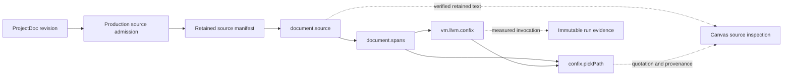

# R3b: retained document traversal

R3b connects a substantial retained legal document to the existing LCNC walk,
real LLVM Confix scanning, deterministic passage selection and browser source
inspection. This is a document traversal increment. It does not decide the
legal dispute, evaluate a Nix expression or replace the curator's managed NLP
and review owners. The bounded Linux x86-64 increment is verified; its
[final combined evidence](evidence/r3b-cutoff-20261105/verification.json) and
[D3M record](../../../../../../tmp/d3m/2026-11-05-airgap-r3b.md) distinguish accepted runs,
failed attempts and remaining gates.

## Source and interpretation boundary

The fixture is the Supreme Court of the United States opinion in
*Coinbase, Inc. v. Suski*, No. 23-3, decided May 23, 2024. The official source is
<https://www.supremecourt.gov/opinions/23pdf/23-3_879d.pdf>. Its retained PDF is
111,243 bytes, with SHA-256
`591f0fdecf41cb297427288a18fd72230e14d4aefe9af4f2d86d6c64dcc4476f`.
The judicial opinion is public domain. Acquisition happened before the
network-isolated run. HTTP affinity cookies are not part of the evidence
packet; acquisition provenance retains only the public URL, time and selected
response metadata.

The PDF contains 12 physical pages. The introductory syllabus is separate from
the Court's opinion; the last pages include a concurrence. Physical PDF page
numbers, printed folios and a legal pinpoint citation are different fields.
The demonstration selects a bounded passage on physical page 10, within the
Court's opinion. It does not label the syllabus as a judicial holding or infer
that this source resolves every Coinbase customer dispute. The case concerns
the relationship between two contracts and who decides which governs.

The retained original is separate from its extraction. `ProjectMiner` invokes
installed Poppler tools and `PageStreams`, which reconstruct line breaks,
separate running heads and footnotes, and attach physical-page/300-dpi line
geometry. This is a derivative with known normalization behavior. Footnotes
are retained separately in `.footnotes.tsv`; a body-text passage is not a
claim to cover those notes, diagrams or the complete legal argument.

A preliminary `pdftotext -layout` extraction used during acquisition is not
the production derivative. Only the actual project's `.extract.md`, matching
`.extract-origin.tsv`, `.extract.json` completion record and footnotes stream
satisfy the lineage boundary used by this run.

## Existing owners and the resulting graph



Preparation admits the real `ProjectDoc` through `document.source` against
`JvmProjectCorpus`: it obtains the completed extraction, hashes the exact
original and extracted bytes, checks lineage/currentness again and retains
its manifest. This happens before the animated run. The graph's `json.value`
node then carries that pinned source reference into `document.source.source?`.
An untyped object does not satisfy a `ProjectDoc` port; the initial probe
correctly refused that construction instead of coercing its declared kind.

The graph resolves the retained reference, verifies its bytes and current
project/extraction revisions again, and records both consumed revisions.
`document.spans` also records those dependencies when used directly. Repeated
consumption of the same revision is deduplicated by the existing ledger. A
manifest reference is not a filename resolved to whichever file exists later.

`view=reference` keeps source output small. The full metadata and layout map
is retained in canonical CBOR without its text body. The text remains a
separate content-addressed blob. Existing inline source output remains the
default for compatibility. A source reference can be resolved only when its
manifest bytes hash to the requested ID, its declared fields agree with that
manifest, and the retained original/extracted bytes match their own IDs.

`document.spans` runs under the existing CAS and project context keys. It
resolves the retained source and checks its currentness before batching. It
creates no thread, executor, model client or independent document database.
Its only new persistence is the ordinary CAS retention of a source manifest
and serialized batch. Production registration belongs to
`DocumentReviewWire`, alongside `document.source`.

The scanner runs under the already established serial LLVM kernel seat.
`confix.pickPath` consumes its copied rows through `Syntax.indexed`, which
constructs the existing Confix facets without scanning. The native branch
navigates those indexed cells and projects the selected value/sheets directly.
It does not call the Kotlin scanner to rediscover the selected structure.

## Identity and offset contracts

| Identity or coordinate | Meaning | Required check |
|---|---|---|
| Original CID | Exact retained PDF bytes | Hash original bytes; source revision must match |
| Extracted-text CID | Exact UTF-8 encoding of `.extract.md` | Hash complete derivative, not a preview |
| Source-manifest CID | Canonical CBOR metadata, revisions and anchors, excluding text | Hash manifest; reference fields agree |
| Batch CID | Exact UTF-8 JSON submitted to the scanner | Equals scanner `sourceCid` |
| Native `open`/`close` | Inclusive byte offsets in serialized JSON | Bounds, order, nesting and parentage checked |
| Quotation `begin`/`end` | Half-open UTF-16 range in extracted text | Exact substring; do not split a surrogate pair |
| Anchor page/coordinates | Physical page and derivative line box | Preserve extraction's supplied values |

The JSON batch contains metadata, escaping and UTF-8 text. Its byte offsets
cannot be added to a quotation's UTF-16 offsets. A multi-byte character,
surrogate pair, quote escape or newline escape makes such a translation
incorrect. The two coordinate domains stay explicit throughout the graph.

The batch envelope is `document-spans/1`. It records original, extraction and
manifest identities; `offsetUnit=utf16`; `rangeConvention=half-open`;
`coverage=extracted-text-window`; the requested beginning, achieved end, full
text length, `complete`, `nextOffset`, and `spans`. Each span contains its
batch-local index and a `DocumentSource.quotation` map, including the exact
quote and every retained anchor intersecting it.

An anchor can extend outside the bounded quotation. It describes the reader's
retained line geometry, not a newly invented crop of the PDF. Missing layout
and attribution authentication remain explicit unresolved/unverified fields.
The browser can establish content identity and substring equality; that does
not authenticate the publisher or establish the proposition's truth.

## Batching, limits and continuation

The projector accepts an offset from zero through the text length, a count of
1–16, a span width of 2–4,096 UTF-16 units, and an encoded batch budget of
1,024–32,768 bytes. It prefers ending at retained line boundaries. A longer
line is still bounded, and a boundary is shortened if it would cut a valid
surrogate pair. Complete selected spans are retained; their anchor maps are
not clipped to fit a budget.

If the first passage cannot fit, the node refuses with an instruction to
reduce `spanChars` or increase `maxBytes`. If a later passage cannot fit, the
batch ends at its last complete passage. `nextOffset` is the exact continuation
point; `complete=true` means the end of this extracted text was reached. It
does not mean all PDF content, footnotes or legal questions were processed.
An offset at the text end returns an explicitly complete empty batch.

The demonstration requests one passage of at most 200 UTF-16 units in an
8,192-byte envelope. This deliberately exercises a small readable traversal
of a substantial source. It does not benchmark all-page scanning. A caller
may build successive batches using `nextOffset`; this milestone introduces
no autonomous pagination worker.

The independent LLVM limits remain 65,536 input bytes and 16,384 copied rows.
The indexed selector admits only a successful JSON result with a matching
source hash, bounded integer geometry, one root, forward ordered child indices,
complete single parentage, consistent depths, contained non-overlapping
siblings, container delimiters and string keys for object pairs. Maximum
geometry depth is 64. Unknown tags, fractional offsets, cycles, aliases,
out-of-range spans, wrong format or failed scan refuse selection.

These checks are structural and defensive, not a replacement strict JSON
parser or proof that arbitrary supplied rows came from LLVM. Actual engine
provenance comes from the retained invocation and its frozen wire bindings.
The upstream scanner remains permissive. The selected scalar decoder is
explicitly JSON-aware: ASCII digits must not be guessed to be CBOR integers.

Whole-run output, observation and browser payload limits still apply in
addition to the projector and native limits. A batch fitting the native ABI
is not permission to exceed a root run's evidence budget. Omission/reference
envelopes remain visible and must never be treated as executable values.

## Browser inspection and human-rate activity

The existing Spacegraph camera owns the source and result panes. A source node
shows the retained document name and independent original/text references.
`Load retained text` reads the existing CAS block route, checks SHA-256 and
decodes UTF-8 strictly before displaying text. It renders via `textContent`,
not as HTML. The download link for the original is explicit.

A native selection that contains a quotation shows its text, UTF-16 range and
supplied physical pages. `Verify quotation against retained text` re-reads
and hashes the derivative, checks exact substring equality and shows nearby
context. Source reads are bounded at 4 MiB; full-text display is limited to
65,536 UTF-16 units with an explicit notice if shortened. The retained blob is
unchanged. The fixture fits that display window in full.

Both read actions capture the current graph definition, node output and page
owner. A semantic edit or replacement while a read is pending prevents that
response from painting the new result. Reading, hovering, panning and replaying
do not submit another run. The existing R3a observation path supplies sparks,
measured runtime inspection, reduced-motion behavior and identity guards.

The debugger pauses at node boundaries. After stepping the native scanner,
its buffers have been released before the pause ahead of selection. The
animation shows an observed transfer stretched into readable display time;
it is not a claim to see an LLVM instruction pointer or internal progress.

The Evidence drawer's `Show recorded outputs on matching canvas` reads the
frozen program and verifies definition compatibility before projecting
historical outputs. It does not establish current project revisions, seed a
new execution frame or recreate the native context. This makes source and
quotation inspection available after the LLVM owners have been drained.

## Reproduction and acceptance

Use the production project storage/miner and configure the pinned Confix
profile documented in [R2](02-confix.md). Construct the five nodes above,
with `document.source view=reference`, `document.spans` at the desired retained
text offset, `vm.llvm.confix format=JSON`, and `confix.pickPath geometry=native`
with `path=spans.0.quotation`. Wire `rows`, `sourceCid`, `ok` and `format` from
the scanner, and the same passage `data` to both scanner and selector.

Acceptance must retain the actual production extraction, source manifest,
batch, native invocation, final quotation, all eight observed wire transfers,
compiled JVM/browser identities and network boundary. It must show a real
pause and continue, source/quotation hash verification, refusal after editing
the program, and identical source inspection after closing/reopening without
native runners. Failed attempts remain part of the verification record.

The ingestion seam still uses external processes without an overall process
deadline. Using the pinned known fixture does not establish a bounded hostile
PDF ingestion service. The network-isolated proof uses staged toolchains and
caches. Portable runtime/dependency closure and clean-machine installation
remain the separate R4 gate.

## Verified checkpoint — 2026-11-05

The actual production extraction is 23,021 UTF-8 bytes, 22,686 UTF-16 units,
with 431 line anchors across all 12 physical pages. Its SHA-256 is
`593fd4088374764d6a3bd3d12dfe9b54b016d8ded783fa466579f41aeb7bf801`.
The selected half-open range `[18477, 18654)` contains 177 UTF-16 units on
physical page 10. It is this exact derivative passage, including its retained
line break and hyphenation:

```text
took this case to decide whether, under the FAA, a court or
an arbitrator decides which of the two contractual provi-
sions controls. We decline to consider auxiliary questions
```

The native invocation scanned a 2,028-byte JSON batch into 151 rows. The
selection used those copied rows after bridge buffers had been released.
The receipt retained all eight actual consumed-wire observations with zero
owner omissions, plus both consumed project revisions. Source loading and
quotation verification caused no additional execution.

All **149 selected JVM regressions** passed, with zero failures, errors or
skips. All JVM main and test sources compile. JS main, Documents and Spacegraph
production bundles, Wasm-JS, Wasm-WASI and Linux x64 compiled using pre-staged
caches in OS network namespaces with loopback only. These are selected
regressions and target compilation, not the full repository test suite.

The final production browser passed **nine document cases** and **11 earlier
animation/replay cases** on the recorded JVM/browser artifacts. Document cases
cover actual moving consumed wire and node-boundary pause, native quotation,
durable transfer identities, complete extracted-text display, native evidence,
replay without another run, refusal after a semantic edit, a delayed output
read superseded by replay, and reopening without native runners. The final
source and quotation panes avoid the generic result-height cap; raw output
fields remain available in a collapsed disclosure. Browser geometry assertions
and screenshot inspection establish that the quotation is visible.

The reopened proof uses a fresh module context against the same disk-backed
store inside the same JVM. Native owners are drained before reopening. The
immutable invocation ledger remains byte-identical; source hashing and exact
quotation verification still succeed. A fresh process/root filesystem remains
part of R4, not an implied property of this check.

Failed probes remain retained: an invalid ProjectDoc wire declaration, an
omitted fixture registry, exact integer transport comparison, optional-port
aliases, and a JVM access error in deferred recursive array projection. A
successful but clipped screenshot precedes the final readable browser build.
The verification manifest qualifies each artifact; no earlier failure is
relabelled as acceptance.

## Final D3M cutoff verification

The frozen all-head cutoff added KIF comment detection and independent required
annotation-anchor coverage. The resulting executable source is
`7a6d7b25e076af6b955c5dfc9902c9613140215c`. A fresh combined build passed **201 selected JVM
regressions**, including the earlier 149 plus relevant KIF/RDF/intake and
annotation-coverage checks. All listed target compiles passed. The actual PDF
traversal and all nine document browser cases ran again on these new JVM/JS
artifacts, as did all 11 animation/replay cases. There were no failures, errors
or skips in that selected JVM run.

The [earlier evidence packet](evidence/r3b-20261105/verification.json) remains
unchanged; it records its own artifact identities, repair history and the
incomplete socket-hang-up attempt. The [cutoff packet](evidence/r3b-cutoff-20261105/verification.json)
records the final combined source, exact artifacts and repeated execution.
It does not retroactively change the standing of an earlier run.

The cutoff inventory contains 521 refs: 511 remote branches, nine local branches
and origin/HEAD. Eleven sequential ordinary merges completed without textual
conflicts. Later remote branch arrivals belong to the next D3M cycle; remote
master ancestry is checked again before the ordinary publication push.
