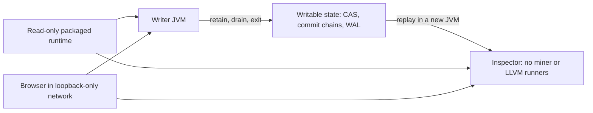

# R4a: packaged document runtime and fresh-process recovery

R4a advances the [retained PDF traversal](05-document-traversal.md) from a
workspace-backed fixture to a packaged Linux x86-64 runtime. The release gate
is a real document run inside a fresh filesystem namespace, followed by a
second JVM that recovers the saved evidence without extraction or LLVM.
Full source-build reproducibility, other platforms and the complete daemon's
optional services remain separate gates. This work ran in the cloud Linux
checkout, not on Jim's Mac.

## The executable composition

The entry point is
`src/jvmTest/kotlin/borg/trikeshed/lcnc/AirgapDocumentMain.kt`. It is packaged
alone, with its generated coroutine classes, by `airgapDocumentEntryJar`.
The entry point supplies fixture admission and local test controls; execution
continues through the existing production `ProjectMiner`, `ProjectScopes`,
`JvmProjectCorpus`, `KanbanModule`, LCNC runners, kernel owners and userspace
HTTP listener. No alternate native evaluator, HTTP mock, receipt store or
production class overlay is introduced. Test framework jars are absent.

`airgapDocumentInstall` stages the application in
`build/install/airgap-document`; `airgapDocumentZip` archives it. The package
contains the production JVM jar, 107 resolved runtime dependency jars, the
production Spacegraph web jar and the entry jar: 110 jars in total. The
runtime classpath retains Gradle's declared order. This is the existing full
JVM dependency set, not a claim that every packaged library is required by
this one document graph. No LLM, embeddings or GPU execution is used.

The application also contains `add-mlir.bc`, `confix.bc`, the retained
111,243-byte official *Coinbase, Inc. v. Suski* opinion, acquisition metadata,
and a generated relocatable launcher. The PDF and both modules have fixed
SHA-256 identities checked before their use. The extraction identity must
match R3b's 23,021-byte UTF-8 text. The fixture refuses an extraction change;
it does not silently update the expected quotation.

## Filesystem and network boundary

The sealed filesystem contains the application, GraalVM CE 25.3.4.1, Poppler
25.03.0, DejaVu fonts, fontconfig and Poppler data, plus the dynamic library
closure. All 77 JDK ELF files were inspected with `ldd`; the combined Java,
PDF and launcher closure contains 80 system libraries. Package provenance
covers 77 Debian binary packages from 65 source packages. The generated
launcher needs `/bin/sh`, `uname`, `ls`, `xargs`, `echo`, `sed` and `tr`; these and
their library dependencies are included and exercised.

The host starts a Linux user/network namespace, brings up loopback and
verifies that there are no routes or non-loopback interfaces. An external
TCP connection fails with `ENETUNREACH`. Within that namespace, bubblewrap
creates a separate user, PID, IPC and UTS namespace. It mounts the packaged
root read-only, writable `/state`, fresh `/tmp`, and namespace-local `/proc`
and `/dev`. It clears the inherited environment and drops capabilities.
The Java process cannot see `/workspace` or `/home/agent/.gradle`.

Only the bounded fixture settings are restored: the packaged JDK and PATH,
the text-layer PDF route, local state paths, and the two module profiles in
`run` mode. No workspace caches, model credentials, original download path or
host toolchain directory are mounted. Runtime inspection retains the JVM's
own mount table, mappings, status, CPU duration and uptime. The browser runs
outside the sealed filesystem, in the same loopback-only network namespace,
and reads the production web bundle over the actual HTTP listener.

This is a fresh-filesystem test on the existing Linux kernel. The host
kernel, bubblewrap, Python test controller, Node/Playwright and Chromium are
explicit external verification inputs. It is not a fresh VM or bare-metal
installation, and it does not seal the browser or the full test host.
The application airgap setting separately prohibits model egress; it is not
used as a substitute for the network namespace.

## Two JVMs and durable ownership



`run` requires fresh state. It opens a durable main Couch commit owner and
the existing durable per-project owners. `ProjectScopes` keeps the mount
ledger and project commit chains beside the shared file CAS. The miner
retains the PDF and its five derived/annotation documents. The fixture
records their complete `ProjectDoc` revisions, the admitted source reference
and passage offset; that metadata is not a replacement for stored bytes.

The browser authors the five-node document graph from that admission. It
steps through production execution, observes moving consumed-wire sparks,
inspects the native measurement, verifies the exact retained quotation and
plays back the immutable receipt. The graph performs the same bounded
passage traversal as R3b: 2,028 JSON bytes, 151 copied native rows, eight
consumed wires and two project revisions. Native buffers are released before
the host projection is used. This remains a bounded passage, not exhaustive
analysis of all twelve pages or a legal conclusion.

After the live page closes, the controller asks the first JVM to finish,
waits for its zero exit status and retained cleanup report, and only then
starts `inspect`. The second process has a different boot identity and host
PID. Installation assets and bitcode are hidden, and the two Poppler
executables are replaced by non-executable device mounts. The inspector
does not construct a miner or register native runners.

`inspect` calls the existing project-ledger replay, checks every saved
document revision and SHA-256 against recovered bytes, and opens the Kanban
receipt store. The browser reads the exact same invocation ledger and
receipt, renders the original extraction and quotation, and replays observed
wires. There is one submitted LCNC run across both JVMs. A host-side restart
marker only coordinates the two real processes; it supplies no HTTP response
or recovered application data.

Shutdown releases route admission, joins the listener, drains and closes the
Kanban module, drains native owners, joins the owning job, drains project
stores and closes the main Couch commit owner. The proof records those
completions for both JVMs. This verifies a graceful process restart. It does
not establish power-loss recovery, kill-at-any-instruction safety or a hard
native execution deadline.

## Resource interpretation

The launcher sets `-Xmx768m` and `-XX:ActiveProcessorCount=2`. These are JVM
configuration settings, not an OS memory limit or CPU quota. Startup latency
is measured from process launch to the first successful state response;
the writer's value includes source ingestion and native setup. The reader's
value includes durable replay and source verification. Both are single
observations on a shared build host, not a throughput benchmark.

The first successful harness sampled bubblewrap's memory rather than the
JVM because the nested user namespace restricted process-tree inspection.
Those numbers are rejected as Java resource measurements. The final entry
point retains `/proc/self/status` from Java itself, including `VmHWM`, and
uses `ProcessHandle.info().totalCpuDuration()` for process CPU time. These
measurements exclude the browser and do not aggregate every short-lived
Poppler child. The evidence preserves the earlier measurement mistake.

## Integrity, sources and reproducibility

The package manifest enumerates every regular file with its relative path,
byte length, mode and SHA-256. A standard `SHA256SUMS` also covers the manifest.
Verification rejects changed contents, changed modes and unexpected package
members. The expected manifest digest must come from the retained release
record; self-consistent hashes are not a publisher signature.

The source companion retains all 65 identified Debian source packages,
their DSC files and the source archives checked against the DSC SHA-256 and
length fields. It retains all 107 coordinate-matched Maven source jars,
cached POMs and embedded notices, plus the Graal and Labs OpenJDK archives
named by the JDK's `SOURCE` metadata. The inventories distinguish HTTPS
acquisition and hash verification from signature authentication.

The vendor JDK records `f471c3eca821+`; the `+` prevents treating an upstream
archive alone as proof of all vendor build modifications. Maven source jars
also do not by themselves establish the complete rebuild inputs of every
embedded native resource. R4a therefore makes no claim of complete
corresponding-source or bit-identical source-build closure. The archive
reproducibility check concerns packaging the same pinned input bytes with
normalized ordering, timestamps and ownership. A minimal dependency profile,
vendor patch/build provenance and complete native rebuild instructions
belong to the next R4 gate.

## Reproduction and retained evidence

Build the application with the repository's Gradle wrapper and pinned JDK:

```
./gradlew --offline --no-daemon --max-workers=2 airgapDocumentZip
```

Offline dependency staging is a build prerequisite. The application ZIP
requires the documented JDK and OS tools; the separately assembled rootfs
carries those runtime bytes. The packaged
[`README`](../../release/airgap-document/README.md) describes the entry
arguments, local control endpoints and profile environment. The retained
controller and browser driver show the exact namespace mounts, launch
command, authored graph, pause sequence and restart protocol. Their `.txt`
suffix preserves them as evidence under the repository's no-scripts rule.

Preserve file permissions when extracting the trusted runtime archive:

```
tar -xzpf airgap-document-r4a-linux-x64-2026-11-05.tar.gz --no-same-owner
```

The initial extraction omitted `-p`; the host's restrictive umask changed
permissions and the manifest correctly refused that copy. After extraction
with preserved permissions, the complete file/mode/manifest check passed and
the full browser run and process restart passed again from the extracted
archive. The earlier rejection is retained.

## Accepted R4a checkpoint

The [immutable verification packet](evidence/r4a-20261105/verification.json)
records combined source `2323b4f39e7b19f37168c014fa15bf1fe5832346`, 219 selected
JVM regressions with no failures or skips, the listed platform compiles, ten
browser cases, four startup refusal cases and five integrity refusal cases.
The [D3M record](../../../../../../tmp/d3m/2026-11-05-airgap-r4a.md) covers 529 frozen refs and
nine sequential merges with no conflicts. The [independent CAS audit](evidence/r4a-20261105/packaging/independent-cas-audit.json)
verifies all 27 retained CAS objects, identical run rows across the two JVMs,
the receipt/program/invocation identities, all eight consumed wires and the
exact UTF-16 quotation directly from retained bytes.

| Final extracted-archive run | Writer | Inspector |
|---|---:|---:|
| Launch to first ready response | 3.043 s | 2.234 s |
| Java `VmHWM` at finish request | 399,112 KiB | 386,500 KiB |
| Java CPU duration at finish request | 11.84 s | 7.59 s |
| Additional LCNC run submitted | 1 | 0 |

Those resource observations precede final shutdown and exclude the browser
and separate PDF-tool processes. Both JVMs subsequently exit zero with the
expected owner/listener cleanup records. They are measurements of this one
bounded run, not limits or performance guarantees.

The sealed root has 1,593 manifested files containing 1,395,770,586 bytes,
plus its two manifest files. Both independently emitted runtime archives
contain exactly 715,928,768 bytes and share SHA-256
`81348e664c96af611aba391b3a377c865608980c30eba19382f13397614ce3a7`.
The separate source companion contains 727,855,562 bytes, SHA-256
`78eded314b22d705356e3bd4988b0774887b42ef054de5879519e291fcb8f61f`.
The application-only ZIP contains 325,647,921 bytes; its digest is in the
verification packet. All 118 application ZIP files were compared byte for
byte with the application inside the sealed root.

The accepted proof is `accepted/` in the packet. Preliminary attempts retain
the namespace capability error, the first successful direct-Java run with
rejected monitor resource figures, the missing external `echo` that caused
the generated launcher to drop JVM options, and the successful launcher run
before archive extraction. These are not counted as extra acceptance cases.
R4a closes this bounded runtime/startup/restart increment. Minimal closure,
full vendor/native source-build provenance, crash recovery and wider domain
capabilities remain open.
