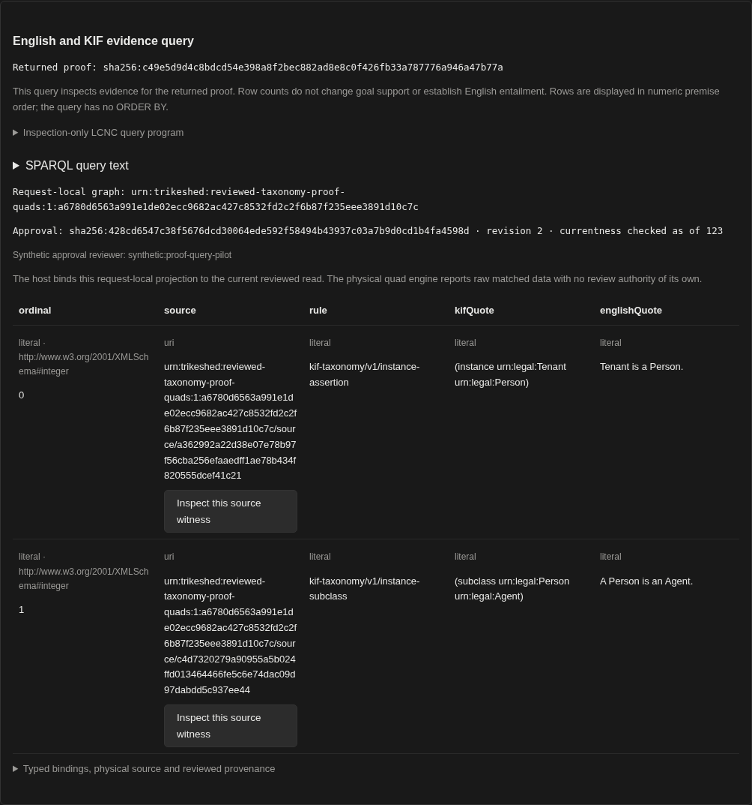
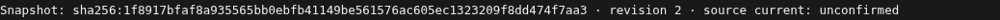

# v75 native reviewed evidence queries

**PASS**, pinned to source `9a4eaac3d7bbde1ab52a7aae6a23a1cda7ab34b3`, main JAR `a15bee549a19af990aa57a34cccde775737633bb11418e116ace183c8dc2f867`, and Documents `0a113702e34733420087b52780d42f2ad0bed3a890b9b9fa5aacac609072822d`. Root's 469 selected JVM checks passed with zero failures, errors or skips, all JVM test sources compiled, and all three browser bundles built. The later LDA/v76 work is a separate checkpoint; these records are not relabelled as that source or artifact.

The native reviewer opened genuine retained inspection `sha256:3f958801fe455258b0b4dea29a8cc4b77c26ce508e8988b67055c67cde221a0d` for the unchanged 41-byte copular source. A fresh, explicitly synthetic reviewer manually declared and approved `Tenant instance Person` and `Person subclass Agent` in one context. Clicking **Query KIF evidence** and **Query English and KIF evidence** sent actual protected requests containing inspection-only LCNC query programs with six and eight basic graph patterns. The real request-local quad engine returned two typed rows each. There is no token, caller-selected dataset or endpoint in either program and no new procedure-execution adapter.



The table shows xsd:integer ordinals 0/1, URI source resources, literal rule IDs and exact KIF/English quotations. The UI displays numeric premise order; raw engine binding order is also retained and no `ORDER BY` promise is invented. Six native table source-button clicks focused the matching English/KIF evidence card without changing the Documents URL/hash. The [KIF-only table](native-kif-six-pattern-typed-query-rows.png), actual request programs, rendered SPARQL, raw typed bindings and DOM cells are retained.

The named graph is derived from the authenticated host report's `readFrameCid`. It contains 107 quads in this fixture and is distinct from the plan frame, query ID and export CID. Host provenance binds the snapshot/revision, approval/decision/read, goal/status, source revision, synthetic reviewer and checked-as-of value. The synthetic fixture clock is 123; this is not a real-world authentication timestamp. The engine's unchanged `physicalSource` reports raw matched `quad-store` data with review authority and binding provenance **not-established**. The host wrapper supplies current-review provenance separately. Data-row counts do not change goal support or establish English entailment.

Four direct actual HTTP controls returned 401 without authentication, 405 for the wrong method, 400 `invalid_visual_program` for a forged non-inspection program, and 413 `visual_query_refused` for a validly wired nine-pattern program. None returned partial results, a quad query or a fallback plain report. These are direct API controls; they do not claim native UI delivery of a 400/413 response. Their existing native view was unchanged. No engine response was fabricated or injected.

Plain proof, typed reverse UNKNOWN and source-backed reflexivity still worked. After restoring a visible eight-pattern result, an actual production upload amended the private source copy. Clicking the same native query starter then returned 409, removed both query rows and the old proof, and displayed the exact approved snapshot/revision line as **source current: unconfirmed**:



Eight before/after state comparisons bind actual review WAL and CAS pack bytes/hashes, Rete, readiness blackboard, model/intake counters and bag/KIF-bank presence. There was no configured global QuadStore; architecture uses a fresh `SparqlSurface(projection.store)`. This is configured-state invariance plus a request-local source contract, not a universal global-store claim. The query graph and computed frame/export identities do not need to exist in CAS.

The twenty actual document/review requests, three successful native queries and four refusals are captured. After writer PID106034 closed all owners, reader PID106400 independently reopened the production CAS and CRC-framed review WAL: eight retained artifacts, two snapshot/approval frames and identical closed CAS/WAL bytes. Stored response checks used the public pure helper without re-executing SPARQL. The actual amended source head/mirror stayed amended; nothing was rewound. All 120 classpath JARs, 119 dependency hashes and production origins—including QuadStore, SparqlWire/Surface, projector and query view—were bound to the frozen JAR, with no friends, live classes or overlays.

[Machine summary](summary.json) · [Independent audit](audit-report.txt) · [Twenty-six rejected mutated-copy controls](audit-result.json) · [Exact compressed records](records.tar.gz) · [Extracted-records audit replay](extracted-records-audit-result.json) · [Root build provenance](root-build-provenance.json)

The first observer compilation, native run and after-close run passed. The earlier root test-source compile failure and its test-only fix are preserved with their logs. No production code or Gradle output was changed by the proof worker. The SDK was actually empty; no fresh parser/model or world-fact admission occurred. Original parser metadata is retained, not newly executed or reauthenticated. Manual reviewed assumptions, physical matched data and host review authority remain separate; no independent English entailment or proof-validity claim is made. Process-local syscall denial, configured-state checks and clean reopening do not establish an OS sandbox, permitted model transport or crash recovery.

Safely extract `records.tar.gz`, copy `audit.py.txt` to an external location, and supply the matching frozen snapshot/dependencies to replay the standard-library recorded-data audit:

```text
python3 AUDITOR_COPY EXTRACTED/proof/native-v75-attempt1 /workspace/library-files/reviewed-proof-query-v75-proof/snapshot --source-head 9a4eaac3d7bbde1ab52a7aae6a23a1cda7ab34b3 --main-sha a15bee549a19af990aa57a34cccde775737633bb11418e116ace183c8dc2f867 --documents-sha 0a113702e34733420087b52780d42f2ad0bed3a890b9b9fa5aacac609072822d --archive EXTRACTED/source/positive-unmutated-runtime.tar.gz --out AUDIT_OUTPUT
```

The packaged archive was safely extracted and this audit replay passed, including all 26 mutated-copy controls. The audit launches no browser, JVM, HTTP client, parser, query engine or reasoner. It checks exact program/query serialization, typed raw/DOM rows, canonical IDs and source joins, all actual state snapshots, focus/routes, refusals/currentness and closed bytes. The archive contains native output/PNGs, protocol/code/input manifests, raw request/responses, original producer archive, actual amended runtime, CAS/WAL, frozen metadata and build logs; large engine/browser binaries remain excluded and pinned.
