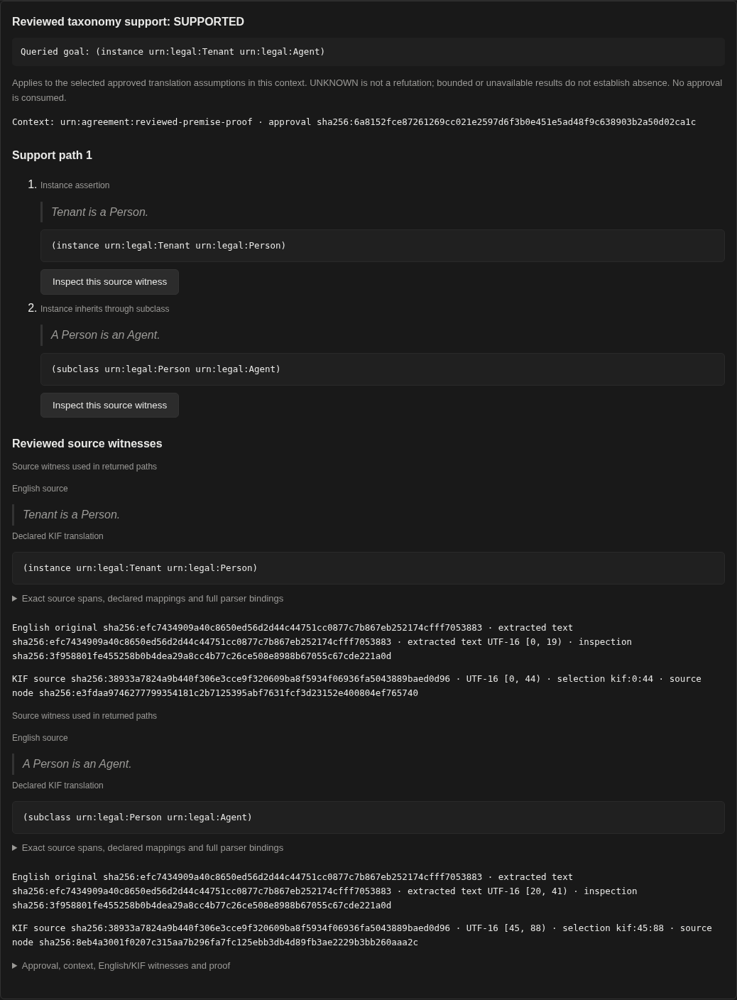
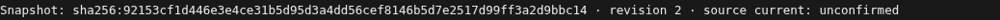

# v74 native reviewed taxonomy proof paths

**PASS**, using final source `ddce0153ef4cb625b30b2cc5ca47cec98dddfa3e`, main JAR `b8cfd4ac9b641df161c5aa8edc6f15c9dfde63f0dec12bdda6b4f5595fb64233`, and corrected Documents bundle `2ce1d1463fb7aedfe62e744f336e2ce0307c237463469c6b263459b60857c62f`. Root reran 457 selected JVM checks with zero failures, errors or skips, compiled all JVM test sources and verified all three browser bundles. The selected native attempt is `native-v74-attempt2`.

The default retained reader opened the genuine 41-byte source, `Tenant is a Person. A Person is an Agent.`, from original inspection `sha256:3f958801fe455258b0b4dea29a8cc4b77c26ce508e8988b67055c67cde221a0d`. An authenticated, explicitly synthetic reviewer chose the instance/subclass mappings and one context, previewed them, froze the exact selection and approved it through the real review WAL. No new parser or model ran. The positive result is conditional on those manual translation assumptions; original parser metadata remains retained, not reauthenticated.

The actual native result visibly displays the ordered rules, each premise's English quotation and declared KIF, then its precise source-evidence card. Raw JSON details stayed closed:



The two steps are `Tenant instance Person` followed by `Person subclass Agent`, with English UTF-16 spans `[0, 19)` and `[20, 41)`, and distinct derived-KIF spans `[0, 44)` and `[45, 88)`. Four real source-button clicks across the positive and reflexive views focused the matching within-document evidence card while preserving the entire Documents URL/hash and selected document. Cards identify the original/extracted English CID, inspection I, derived KIF CID, source node and occurrence spans. This is evidence-card navigation, not original-source or PDF-page navigation.

The reverse, well-typed `subclass(Agent, Person)` query returned **UNKNOWN**, no proof paths and two separately labelled unused sources. `subclass(Person, Person)` returned two actual alternatives, each with one declaration witness; no contextless reflexive proof was invented. Every displayed proof/source/premise order matched the host's canonical length-framed export and full approved source projection. Bounds and truncation were preserved. See the [UNKNOWN view](native-unknown-no-proof-visible-proof.png) and [source-backed alternatives](native-source-backed-reflexivity-visible-proof.png).

A separate, actual production upload amended the private source copy, changing its CID/revision/sequence and persisted head/mirror. The next protected read returned **409**, cleared the old proof result and displayed exactly one snapshot/revision-bound currentness line as **unconfirmed**:



[Full stale/refusal view](native-actual-source-amendment-refuses-old-proof.png). Staleness was not presented as UNKNOWN. The original source archive and first runtime were never rewound. The old immutable carrier remains readable as historical material, without current authority.

There were twelve actual document/review HTTP requests: retained200, reviewer sessions401/200, candidates200, preview200, snapshot200, unapproved409, approval200, three successful protected reads and stale409. The review WAL contains only two CRC32C frames, snapshot and approval, totaling 194 bytes. Seven actual WAL byte/hash/base64 captures show that authentication and subsequent proof/UNKNOWN/reflexive/stale reads append no review decisions or consume approval. After all writer owners, executor and listener closed, a different process used final-JAR production carrier/CAS/WAL readers to verify eight exported artifacts, unchanged WAL/CAS bytes and the actual amended source head/mirror. Both processes used only the frozen 120-JAR classpath, verified all 119 dependency hashes and production origins, and used no overlays, friends or live classes.

[Machine summary](summary.json) · [Independent audit](audit-report.txt) · [Fourteen rejected mutated-copy controls](audit-result.json) · [Exact compressed records](records.tar.gz)

The independent Python standard-library audit checks canonical CBOR, existing export/identity domains, approved English/KIF quotation joins, actual ordered DOM/cards, URL/focus, currentness label, review WAL CRC, retained bytes and separate-process closure. It rejects fourteen mutated in-memory copies. The same final auditor passed after safe extraction of the final archive; the preserved earlier auditor also passed its original scoped records. It does not independently prove English entailment or inference validity, authenticate the source, grant a sink permit or admit world facts. The SDK was actually empty; fresh Inspect, model, automatic intake and analysis Rete counters stayed zero, and the readiness blackboard stayed unchanged. Process-local denied outbound syscalls and zero browser external requests do not establish a global OS sandbox or exercise a permitted model transport. Reopening proves clean closure, not crash or power-loss recovery.

The [before-label-correction records](before-label-correction/README.txt) retain source `dc4686a399f606397fc8aa6221055f40f5272d41`, old Documents `db21e0de…`, their thirteen-control audit and actual amended runtime. Those path/WAL/CAS checks passed, but visual review found the cached line still said `source current: true` after409. Root's one-line JS correction produced the new bundle above. The fresh final runtime used a new original archive copy. The preliminary observer missing-import compile log is preserved; no product code or build configuration was changed by the proof worker to force a pass. The [root build provenance](root-build-provenance.json) and archived failure logs retain the protected test-constructor, intake-owner race and airgap-policy test follow-ups before the final GREEN.

To repeat the read-only audit, safely extract `records.tar.gz`, copy `audit.py.txt` to an external location, and supply the matching frozen snapshot and dependencies:

```text
python3 AUDITOR_COPY EXTRACTED/proof/native-v74-attempt2 /workspace/library-files/reviewed-taxonomy-path-v74-proof/snapshot-label-v2 --source-head ddce0153ef4cb625b30b2cc5ca47cec98dddfa3e --main-sha b8cfd4ac9b641df161c5aa8edc6f15c9dfde63f0dec12bdda6b4f5595fb64233 --documents-sha 2ce1d1463fb7aedfe62e744f336e2ce0307c237463469c6b263459b60857c62f --archive EXTRACTED/source/positive-unmutated-runtime.tar.gz --out AUDIT_OUTPUT
```

The archive includes both actual attempts and screenshots, per-attempt observer protocol/input manifests, HTTP/DOM/state captures, CAS and review WAL, source amendment bytes, the original producer archive, compile logs and both frozen metadata sets. Large engine/browser binaries are excluded and pinned. The audit launches no JVM, browser, parser, HTTP client or reasoner and requires the recorded frozen artifact paths for strict origin binding.
