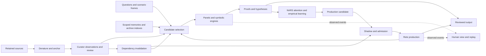

# Tier architecture and coordination

## Logical topology

The left, middle and right are roles in a graph. A factory may contain several intake groups, successive interpretation layers, parallel panels and multiple production groups. Recursive analysis is an explicitly bounded scope. A steady-state loop returns observations and invalidations to earlier scopes without confusing an earlier conclusion with new source evidence.

## Tier responsibilities

| Tier | Owns | Produces | Does not infer implicitly |
|---|---|---|---|
| T0 Acquisition boundary | Capture, import, transport manifest | Original bytes and acquisition receipt | Source truth, review approval |
| T1 Document structure | Safe rendering, text extraction, layout, offsets | Anchored pages, clauses, transcript segments | Legal meaning or world facts |
| T2 Curation and retrieval | Candidate extraction, identity resolution, source selection | Observations, reviewed mappings, query worksets | Negative premises from missing rows |
| T3 Intent and analysis | Question frames, role panels, proofs, alternatives | Scoped answers, arguments, hypotheses, unresolved frontier | Global conclusions outside selected context |
| T4 Consolidation | Empirical updates, candidate rule economics, validation | Versioned production candidates and review packets | Authority from popularity or confidence |
| T5 Production | Guarded matches, local effects, outcome receipts | Operational events and published artifacts | New evidence merely by reusing a rule |
| Cross-cutting plane | Identity, provenance, budgets, events, policy | Consistent receipts and projections | Permission through UI placement |

## Control, data and observation

Data channels carry immutable artifact references plus a bounded preview. A large PDF, parse tree or proof DAG is stored once and read by reference. A channel is not allowed to carry a live mutable host object across an untrusted guest boundary.

Control channels carry host-authorized commands: admit a run, set an inspection hold, change a budget at a declared boundary, drain a scope or fork a graph version. They never share the same untyped port as source text. A document saying “approve this” is data.

Observation channels carry receipts and measurements. Some observations are critical semantic events and need durable retention before a claimed effect can proceed. Other observations are high-rate counters that can be aggregated. The UI reads these channels and cannot issue execution by replaying them.

This three-way distinction is semantic, not an instruction to introduce three new frameworks. Compose existing CCEK elements and channels. The schemas in [wire contracts](19-wire-contracts.md) describe boundary values, not a replacement object hierarchy.

## Engine contract

Each engine descriptor declares an input schema, supported logical fragment, output result taxonomy, execution determinism, local resource requirements, network capability, checkpoint granularity, observation granularity and cancellation behaviour. Pin executable and asset identities. “Available” means the required artifacts and runtime passed readiness checks; a catalog entry alone is insufficient.

The host validates a requested adapter before dispatch. A Horn engine accepts its declared Horn frame. A text ranker accepts text candidates. A model may propose a formalization, but the proposal passes a separate mapping and admission boundary before a proof engine treats it as an assumption.

Checkpoint capabilities include `node-boundary`, `batch-boundary`, `cooperative-step` and `process-restart-only`. These describe real adapter behaviour. An engine without internal observations displays elapsed time, admitted work and process metrics; it must not fabricate an internal progress percentage.

## Coordination of parallel analyses

A panel invocation binds a question, source frame, scenario, engine versions, seat specifications and budget. Seats can run independently. Fan-in has a declared completion policy: wait for all, quorum of eligible results, first satisfactory result, or deadline with a partial result. The policy identifies which seat failures prevent publication.

Each result includes the same question/frame identities and its own supporting artifacts. The join rejects results from a prior source revision or a sibling scenario. A timed-out seat remains timed out; the panel does not quietly change its denominator from five seats to four and display unanimity.

Use deterministic seat ordering for replay. Scheduling can be concurrent, but the retained reduction procedure is explicit. A later reviewer can reconstruct why a branch was selected. Ties, abstentions, duplicate source support and correlated model outputs remain visible.

## Recursion and branch control

The initial traversal is breadth-first within a bounded issue layer, then priority-based expansion. This gives the operator a useful overview before one difficult branch consumes the budget. Priority combines declared user importance, unresolved dependency count, estimated cost and an explicitly labeled heuristic for expected value of information. It is not a probability of legal correctness.

Each branch has a context frame, parent question, generated alternatives and a terminal reason. Limits include maximum depth, total admitted branches, per-parent fanout, active seats, solver work, elapsed time and total artifact bytes. A local depth limit does not bound total width, so the global admission counter is mandatory.

Canonicalize question-plus-assumption-set identities to detect repeated subproblems. Memoization includes source, policy and engine versions. If a cycle recurs without new information, retain a cycle edge and stop expansion. If information changes, use a new epoch and consume another explicit budget unit.

## Shared identities

The minimum identity chain is source artifact → extracted view → observation → assessment → scenario frame → engine invocation → result → production candidate → deployment generation → effect receipt. Not every path uses every stage. A simple regex query can stop at observations; a synthetic theorem may start with explicit host-authored assumptions.

Content identity is separate from run identity. Identical source bytes may appear in two acquisitions. The bytes can deduplicate while acquisition provenance remains plural. Two repeated executions can share input and output content IDs while retaining separate attempt IDs and costs. Distinct attempts do not create independent semantic evidence.

## Persistence and recovery

Use immutable CAS artifacts for payloads, an append-only semantic journal for decisions and effect boundaries, and rebuildable indexes for retrieval and visualization. Persist a committed event only after its referenced payload is readable and hash-checked. If journaling fails before an authority-changing action, refuse that action. For high-rate diagnostic data, record a gap and preserve semantic operation.

A snapshot binds a journal watermark and the artifact/index generations needed to reconstruct it. After a crash, replay committed semantic entries to the latest watermark. Reconcile admitted work whose completion is unknown. An effect adapter must use an idempotency key or expose uncertain outcome; automatic retry cannot promise exactly-once effects without a cooperating sink.

## Change propagation

Source replacement, review withdrawal, ontology revision and engine-policy change emit invalidation events. A reverse dependency index finds affected proofs and productions. The first implementation rebuilds affected query frames and suspends affected production generations before use. Incremental truth maintenance is an optimization to add only after comparison with full recomputation.

Unrelated scopes continue when their input identities and dependencies are unchanged. A global “everything stale” mode is safe but expensive; a precise dependency index is the eventual target. If dependency coverage is incomplete, conservative wider invalidation is required and visible.

## Deployment shapes

Start with a single workstation, local browser, host daemon, isolated parser/solver workers and local content store. This minimizes distributed coordination while exercising the same artifact and event contracts. Add additional CPU workers only after one-host accounting, replay and invalidation work.

For compatible `mlir-nix` bitcode, the intended embedding route is now an owned in-process JVM Polyglot context, following the [Sulong pivot](22-mlir-nix-polyglot.md). Engine descriptors distinguish that trusted profile from workers requiring process containment. A binary kernel, a bitcode evaluator and complete dialect lowering are separate capabilities; none acquires another's semantic or resource guarantees merely by using LLVM. Retain the existing supervised solver as an explicitly named backend until the replacement meets its acceptance gates.

Connected acquisition and frontier development run in a separate environment. Transfer reviewed, hash-verified bundles into the offline runtime. An air-gapped lane cannot silently ask a remote provider for help when an optional local model is absent; it returns unavailable, or the operator chooses an explicitly supported deterministic alternative.
