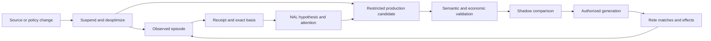

# NARS learning Rete production and deoptimization

## Intended loop

Slow analysis produces proof receipts, hypotheses and observations of work. NARS-like memory prioritizes questions and represents empirical support. A compiler proposes a small production only when the condition/action relationship is expressible, useful and permitted. Shadow execution compares it with the reference path. Deployment makes the shortcut available. Changed evidence or poor performance suspends it and returns work to analysis.

Rete is the matching and activation mechanism for that shortcut. NARS is a revisable inference and attention mechanism. Neither supplies the other's missing authority, calibration or provenance. The NARS literature explicitly treats knowledge and resources as insufficient and beliefs as revisable. [NARS introduction](https://cis.temple.edu/~pwang/NARS-Intro.html)

## Three different reusable products

**Memoized result:** exact same input frame and engine identity reuse a retained output. No learning is implied. Invalidation follows exact dependencies.

**Compiled deterministic rule:** a supported formal rule or verified transformation is specialized into efficient matching. Correctness is relative to the same formal semantics and guards. The compiler must show that the specialization preserves them.

**Empirical policy:** observed cases support a hypothesis that a routing or analysis action is useful. It needs held-out evaluation, abstention/fallback, drift handling and an allowed effect class. It is never presented as a theorem merely because it runs in Rete.

Use distinct candidate kinds and UI labels. Their validation and revocation requirements differ.

## NAL evidence mechanics

Retain frequency and confidence separately from attention budget. For an illustrative evidence interpretation, positive weight w+ and negative weight w− give f=w+/(w++w−), with confidence c=w/(w+k), where the declared horizon k uses the same units as w. The local implementation uses 1,000 milli-evidence units per ordinary observation and has APIs with different default horizon assumptions. Choose the scaled API explicitly. [Local structured activation review](../../nars-structured-activation-plan.txt)

For an illustrative policy with eight positive and two negative independent observations and k=1 observation, f=0.8 and c=10/11. Replaying those ten receipts changes neither value. Two genuinely new positive observations give f=10/12 and c=12/13. These numbers describe that evidence policy; they are not calibrated probabilities of a legal conclusion.

Each observation has a stable receipt ID and exact source basis. Duplicate receipts are ignored. Overlapping or unresolved bases use the existing conservative policy rather than naive addition. A proof with two paths through the same source is one dependent basis. Model agreement over the same prompt/source is not independent documentary evidence.

Packed evidence counts require overflow handling. Before adding, validate bounds and use a declared rescaling or saturation policy that preserves the intended ratio and records lost precision. Do not silently wrap unsigned fields. An evidence policy change produces a new version and recomputation plan.

## Attention before evidence minting

The first integration selects relevant premises before solving and reports its effect with the live bag unchanged. Next, an owner-side operation may adjust attention for an already existing exact receipt/formula. It must verify receipt identity, angular collision handling and residency, and leave evidence bytes unchanged.

Only a later explicitly designed observation bridge mints new empirical evidence. `Reinforce` is not the bridge for replayed proofs because it lacks the needed incoming exact basis. Admission, processing, retention, active residency and later recall are separate measurements. The current 4,096-cell active bag should be stressed with spill and revival, not treated as a 4,096-item total corpus limit.

## Restricted production representation

A candidate contains kind, schema/version, scope, typed variables, positive guards, explicit negative/absence semantics if supported, joins, temporal window, action, source/proof/observation basis, reference evaluator, resource estimate, fallback and invalidation dependencies.

Initial grammar: bounded conjunctions of equality/type/range predicates over admitted facts, exact join keys, optional explicit time-window checks, and a small allowed action set. Start with one to three auditable matching stages, consistent with the existing Rete seam's shallow-production bias. Reject arbitrary generated executable source, unrestricted recursion, open-ended side effects and unsupported negation.

For negative guards, distinguish an explicit negative fact from a closed-world absence test. An absence test is allowed only over a declared complete finite dataset/window with a completion watermark. In an open evidence corpus, no matching row means unknown.

## Candidate generation

Candidates can come from a repeated trace pattern, a verified Horn consequence pattern, an operator-authored decision table or a model proposal. The source changes the candidate's provenance, not the compiler's validation requirements. A model can suggest guards; it cannot grant the candidate deployment authority.

Generalization is bounded: replace specific entities with typed variables only when the training episodes and domain contract support the substitution. Keep role positions, time and jurisdiction in guards where relevant. A rule that succeeds for one account event must not generalize to every Coinbase action merely by sharing a class label.

## Promotion gates

1. **Shape:** supported grammar, total bounded evaluation and permitted action.
2. **Semantics:** declared reference procedure agrees on positive, negative, missing and contradictory fixtures.
3. **Provenance:** exact dependencies and current source/review versions resolve.
4. **Empirical quality:** for empirical policies, held-out outcomes and abstentions are evaluated without duplicate-source leakage.
5. **Economics:** saved work exceeds matching, storage, review and invalidation cost over a plausible reuse count.
6. **Shadow:** execute without effects alongside the reference, recording disagreements and latency.
7. **Authority:** host policy admits the generation for specified effects and scope.

Thresholds are domain/effect-specific. For an initial routing rule, require zero unsafe actions on adversarial fixtures and a measured latency/work reduction; do not invent a universal confidence threshold. Even zero failures in 300 independent trials only bounds an underlying failure rate to roughly 1% at a one-sided 95% level under the binomial assumptions. A small clean fixture set is not broad safety evidence.

## Economics and break-even

Let Cslow be mean reference cost, Cfast matching plus action cost, Cbuild compilation/review cost and Cmaint expected invalidation/revalidation cost. Break-even reuse is (Cbuild+Cmaint)/(Cslow−Cfast), provided the denominator is positive. Measure CPU time, wall latency and money separately; a lower model bill can still increase latency.

For an illustrative rule costing 20 seconds to validate and saving 100 ms per use, break-even is 200 uses before maintenance. A rule invalidated every 50 uses loses economically even if its matching is fast. The UI should show realized savings and maintenance burden, not just match counts.

## Deployment and generation fencing

Register a production through the existing serialized registry owner and retain its disposer. Give every deployment a generation ID. A match creates an activation bound to that generation, input fact versions and scope. Before effect dispatch, recheck that the generation is still admitted and its required dependencies are current. This closes the gap between match time and action time.

Refraction prevents repeated firing on the same unchanged fact tuple and generation. A new independent episode may legitimately fire again. The idempotency key includes production generation, target effect and input episode identity. A cache hit or duplicate delivery must not create duplicate effects.

## Deoptimization

Triggers include source/review withdrawal, ontology or mapping change, invalid guard, counterexample, expired time window, distribution drift, changed effect policy and negative realized economics. Suspension closes new activation admission for that generation. Already-dispatched effects are reconciled; undispatched activations are rejected or returned to analysis. Retain a reason and dependency path.

Revalidation creates a new candidate/generation. Do not mutate an active rule in place. Hysteresis can avoid rapid promote/suspend oscillation, but correctness invalidation bypasses hysteresis immediately. Retain cool-down and minimum-shadow policies as explicit configuration.

## First showcase production

Use a source-bound routing/cache rule: when the same approved source frame and exact question signature recur, reuse the checked deterministic result or route directly to the known bounded solver workset. Its effect is local, its dependency set is exact and its savings are measurable. Then withdraw one source and show suspension, fallback analysis and a new result. This demonstrates myelinization and deoptimization without pretending to compile open-ended legal judgment into a few guards.
