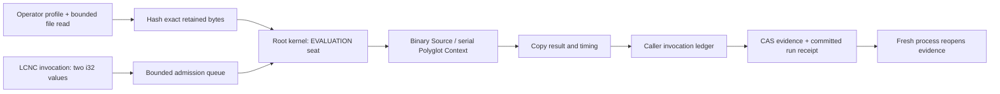

# Owned LLVM scalar demonstration

This continuation implements the transport and ownership part of the
[Polyglot blueprint](../lcnc/airgap-demonstrator/22-mlir-nix-polyglot.md).
`vm.llvm.scalar` executes an operator-selected, SHA-256-pinned binary module
through GraalVM LLVM. Its fixed ABI is `i32(i32,i32)`. The LCNC graph supplies
two integers; it cannot select a path, export, native-access grant or verifier
setting. No new Graal dependencies are needed.

Verified on 4 November 2026 at `0ae529c1a7fc1cd8f289b15e23d8e87f86d82760`,
after the second D3M integration: all three stages below passed. The
[publication manifest](evidence/2026-11-04/publication/verification.json)
records the exact combined source, 19 passing current regressions and execution
without an external network route. JVM main and all test sources, JS, Wasm-JS,
Wasm-WASI and Linux x64 main sources compiled without exclusions. The
[earlier manifest](evidence/2026-11-04/verification.json) separately retains the
forced offline MLIR rebuild and first 13-test checkpoint; its compiler and
fixture inputs are unchanged. Load the retained
[two-node program](evidence/2026-11-04/publication/program.json)
into LCNC after configuring the operator profile below.

The demonstrator has three cumulative acceptance stages:

1. Assemble retained LLVM IR and execute actual binary bitcode with verification
   enabled, including signed boundaries and wrapping LLVM addition.
2. Use the existing commonMain `KernelElement`/`KernelSeat` queue, serialize all
   Context access, settle admitted work before close, and retain copied runtime
   metadata. Reject mismatched pins, malformed bitcode, missing exports and
   invalid scalar input. Exercise cancellation after admission.
3. Lower real standard MLIR arithmetic, run two wired LCNC nodes through the
   production whole-program HTTP route, retain their results and invocation
   evidence in CAS/WAL, and reopen that evidence with fresh owners and no LLVM
   runner. The expected values are `42`, followed by `40`.

These stages do not constitute a general `mlir-nix` evaluator or a legal/Horn
inference engine. `add.mlir` uses standard `func` and `arith` operations. No
`--convert-nix-to-llvm` pass is invented. The upstream native Horn backend and
ordinary `InProcessIsolate` policy remain independent.

## Rebuild and verify

The reproduction toolchain is GraalVM Community JDK 25.0.4.1, Polyglot/LLVM
artifacts 25.3.4.1, LLVM/MLIR 22.1.8, Kotlin 2.4.21 and Gradle 9.8.2. The retained
fixtures target `x86_64-unknown-linux-gnu`; this execution packet is a Linux
verification, not an Apple Silicon verification.

```sh
./gradlew verifySulongDemoBitcode \
  -PsulongLlvmBin=/absolute/LLVM-22.1.8-Linux-X64/bin

./gradlew jvmTest \
  --tests borg.trikeshed.lcnc.LlvmScalarTest \
  --tests borg.trikeshed.kanban.module.LlvmScalarRunTest \
  --tests borg.trikeshed.lcnc.NativeHornProfileTest
```

The build target performs three distinct operations:

```text
add.mlir
  mlir-opt --convert-arith-to-llvm --convert-func-to-llvm
           --reconcile-unrealized-casts
build/sulong/add.llvm.mlir
  mlir-translate --mlir-to-llvmir
build/sulong/add.ll
  llvm-as
build/sulong/add.bc
```

`verifySulongDemoBitcode` compares the rebuilt bytes with the retained test
fixture. It does not silently update that fixture. Explicit SDK executables
are Gradle task inputs, so changing their bytes invalidates the build result.
Without `sulongLlvmBin`, commands resolve through the operator's PATH; use the
explicit SDK for reproducibility.

The separate handwritten fixture is rebuilt with:

```sh
/absolute/LLVM-22.1.8-Linux-X64/bin/llvm-as \
  docs/sulong-bitcode/add.ll -o /tmp/add.bc
cmp /tmp/add.bc src/jvmTest/resources/sulong/add.bc
```

| Retained artifact | SHA-256 |
|---|---|
| Handwritten IR bitcode | `7f657500b8e1b7d2b956ae5529ac7eb1a29df9ba0af1964b64f78986fbc68305` |
| Standard MLIR bitcode | `75c58f04786ec777841e29e185e1c6e59f1efa50afd5f860280b77887674e10b` |
| GraalVM Linux archive | `b2bc38d0c4141426eb44d0eefa3cc172c96faf92727d703b61541699128b6fc7` |
| LLVM Linux archive | `df0e1ecf16caf3489a272a5eea4eec9b0d82878f6477fa309504f918a0006384` |

The old `proof.json`/`proof.txt` remain historical evidence with their original
build identities. Their bitcode hash and byte length differ from this rebuild;
they are not relabeled as evidence for current code.

## Operate through LCNC

Create an operator configuration outside request-controlled storage. Replace
the module path with the absolute location of the verified `build/sulong/add.bc`:

```json
{
  "module": "/absolute/TrikeShed/build/sulong/add.bc",
  "sha256": "75c58f04786ec777841e29e185e1c6e59f1efa50afd5f860280b77887674e10b",
  "export": "add",
  "abi": "i32(i32,i32)"
}
```

Set `TRIKESHED_LLVM_SCALAR_PROFILE` to the absolute configuration path before
starting the existing Oroboros daemon. Omitting it leaves the backend disabled.
An invalid configured profile fails opening instead of selecting another engine.
The operator vouches for the declared ABI and code behavior: `canExecute()` and
`fitsInInt()` cannot introspect or prove an arbitrary native C signature.

Use the existing LCNC surface to place two **LLVM scalar kernel** nodes. Give
the first `left=19`, `right=23`; wire its `value` output to the second's `left`
input and set the second's `right=-2`. Both `left` and `left?` wire spellings are
accepted; duplicate aliases for the same argument are refused. A present wired
null is invalid and does not fall back to a parameter. Fractions, non-finite
values and values outside signed 32-bit range are refused.

For durable evidence, submit a whole program using `/api/lcnc/run` with
`name` and `document` (or a retained `program`). A direct `{type: ...}` single
runner request is not the retained whole-program path. The executable example
is `LlvmScalarRunTest`; it also checks the optional-port wire and parameter
fallback through the real walk rather than calling the runner directly.

The whole-program receipt contains `programCid`, `receiptCid` and
`invocationsCid`. Fetch either evidence object through
`/api/lcnc/content?cid=sha256:...`. The receipt CID identifies a committed command
envelope with an `lcncRun` member; the invocation CID identifies the separate
ledger. Successful demonstration runs also export copies under
`build/reports/sulong/program.json`, `receipt.json` and `invocations.json`.
Those are the exact CAS bytes identified by their CIDs. The separate
`response-preview.json` is a reserialized HTTP response preview and is not the
object identified by `receiptCid`.

The retained run's [receipt](evidence/2026-11-04/publication/receipt.json) and
[invocation ledger](evidence/2026-11-04/publication/invocations.json) show both completed
nodes, the module CID and real boundary timings. The restart test opened fresh
CAS/Couch/blackboard/route owners and recovered these identities without an
LLVM runner. This demonstrates retained execution evidence, not native heap
checkpointing.

## Ownership and observations



One worker and one queued request belong to the existing userspace seat.
`llvm.open` and `llvm.call` are real seat turns. Loading checks the exact bytes
once and evaluates a `ByteSequence` binary Source. The module's returned Value
supplies the fixed export. No Graal Value, pointer or Context leaves the adapter.
The pointcut closes Context after the worker and completion stream drain.

The runtime snapshot records module CID, export/ABI, actual engine and LLVM
versions, native access, verifier setting, load time, queue time and call time.
Times are monotonic nanoseconds at host boundaries. `loadNanos` describes the
one opening, not repeated loading on every call. Queue time includes admission
waiting and scheduling. Call time covers the guest call and scalar conversion;
it is not end-to-end LCNC, persistence or solver latency.

`internalProgress=unobserved` and `pauseBoundary=between-calls` are explicit.
The UI can show measured node boundaries and elapsed work, but this adapter
does not create LLVM instruction events, synthetic percentages, internal
sparks, or an interruptible native timer. Visual renderer/browser acceptance
remains a later demonstrator gate.

After admission, cancellation waits for native execution and completion to
settle before the caller snapshots its invocation ledger; cancellation then
propagates. Drain rejects further admission, completes accepted work, and
closes Context. This preserves evidence ordering but provides **no hard native
deadline**. An infinite or crashing native function can still hang or crash the
host. The scalar profile therefore admits only operator-reviewed bounded code.

Daemon shutdown drains LCNC consumers before the LLVM owner. The outer startup
guard retains cleanup callbacks as soon as owners open; it also joins pending
module startup before draining module consumers, so later startup failure does
not strand the kernel. Failed LLVM opening drains its own partial resources.

## Capability and deployment limits

Host object access, host class lookup, guest IO/environment, polyglot access,
guest thread/process creation are denied. Native access is explicitly granted
because this Sulong runtime needs it; `llvm.verifyBitcode=true` remains enabled.
Native access is not a sandbox. The module pin does not pin every runtime native
library or prove no native system calls occur. Native allocations are not
automatically managed by JVM GC.

The demonstration requires no LLM or accelerator. Rebuilding requires the
pinned compiler SDK; executing retained bitcode does not invoke that compiler.
An offline deployment must still stage and verify the full JDK, Maven runtime,
native support libraries and platform closure, then exercise startup with
network access unavailable. Merely denying guest IO is not an airgap test.

The retained Linux check used `unshare --user --map-current-user --net
--keep-caps`, enabled only loopback for Gradle's local daemon connection, and
ran Gradle with `--offline`. There was no external route. Both the actual LCNC
test run and a forced three-stage MLIR rebuild passed inside that boundary.
The SDK and dependency caches had already been staged; this is not a
clean-machine distribution-closure certificate. Preserve the invoking UID:
an initial root-mapped namespace selected an inaccessible `/root/.cache` for
Graal resources; keeping the current UID corrected that launch failure.

Concurrent Gradle builds on opposite sides of that network boundary need
separate Gradle user homes. Their lock-owner coordination cannot cross the
namespace. The publication check used a separately staged cache through
`--gradle-user-home /workspace/gradle-offline-cache`; it did not relax network
isolation or change source to resolve the initial shared-cache lock timeout.

Before expanding the ABI, select a real bounded upstream kernel, retain its
source revision and license, enumerate native dependencies, and verify its
result against the corresponding Kotlin operation. Pointer/string results
require explicit buffer ownership and release, not `Value.asString()` on a
C pointer. A full Nix evaluator additionally needs lazy values, forcing order,
imports, evaluator heap ownership, errors and deoptimization semantics.

The next review gate is a real `mlir-nix` kernel with an agreed buffer ABI and
semantic corpus. It does not inherit an acceptance claim from scalar addition.
Cross-engine performance comparisons must use matching computations and report
cold loading separately from warm execution. No solver-speedup claim is made.

## Concrete upstream handoff

The next candidate was inspected at `jnorthrup/mlir-nix` revision
`571b57d3ebdcdabe7ac76765b2875de7b98b9dab`:
[lib/Confix/confix.ll](https://github.com/jnorthrup/mlir-nix/blob/571b57d3ebdcdabe7ac76765b2875de7b98b9dab/lib/Confix/confix.ll).
The retrieved 84,381-byte source has SHA-256
`7ba80066f3a8a1775f4a8390d38a8f347c498e5df560bb51b7c18c2fe4de2bc8`.
LLVM 22.1.8 assembled it into 23,168 bytes; `llvm-nm --undefined-only` reported
no undefined symbols. This is a current assembly probe, **not execution or
semantic acceptance**. The source and object remain separate from the scalar
fixture and are not loaded by `vm.llvm.scalar`.

Its public exports are `confix_scan_json`, `confix_scan_cbor` and
`confix_scan_yaml`, each taking two pointers and returning a fault integer.
The IR declares these layouts:

```llvm
%confix.chars = type { i32, ptr, i32, i32, i32 }
%confix.flat = type { i32, i32, i32, i32, ptr, ptr, ptr, ptr, ptr, ptr }
```

The first record supplies size/data and position/limit/mark fields. The second
contains total rows, fault, fault position, capacity and caller-owned array
pointers. The existing scalar ABI cannot safely represent those records.
The next implementation must retain the input bytes and allocate the exact
span/tag/tree/work arrays with checked capacity arithmetic; call the selected
scanner; copy a bounded result; and release every buffer while its Context is
owned. Keep native struct layout and pointer width behind that adapter. Do not
place Java object addresses into these fields or serialize host pointer values
into LCNC receipts.

The upstream source explicitly preserves permissive scanner behavior, including
some text that a strict JSON parser rejects. Therefore compare its row/span/tag
output with the corresponding Kotlin Confix scanner, and separately retain
strict input validation where the application requires it. Scanner completion
does not prove that evidence is valid JSON, that a Nix expression evaluated, or
that a legal proposition is supported.

WP15's next acceptance packet should contain: the pinned upstream source and
provenance; an explicit bounded buffer ABI; target-layout checks; JSON/CBOR/YAML
valid and malformed input cases; capacity and truncation failures; Unicode and
integer-boundary cases; leak/drain evidence; and a whole-program LCNC receipt
whose copied rows agree with the Kotlin scanner. Only then extend the module
catalog or start a comparable scanner benchmark.
